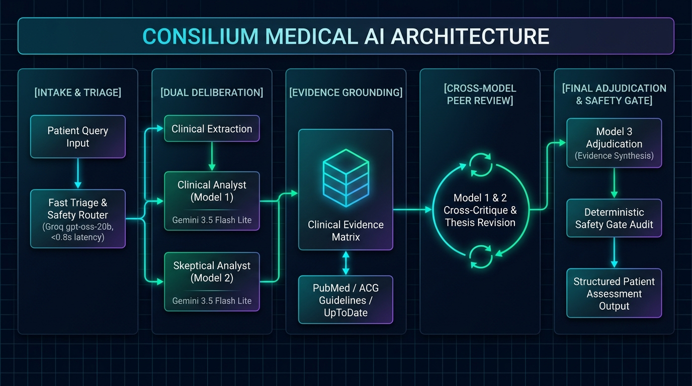

# 🩺 Consilium

<div align="center">

**Evidence-Grounded AI Medical Deliberation & Clinical Decision Support Architecture**

[](https://fastapi.tiangolo.com)
[](https://react.dev)
[](https://www.typescriptlang.org)
[](https://vitejs.dev)
[](https://groq.com)
[](https://ai.google.dev)
[](https://www.python.org)
[](LICENSE)

*A multi-agent council of specialized AI clinicians, skeptical reviewers, and evidence adjudicators that cross-examine, peer-review, and ground diagnostic assessments in clinical literature.*

[Workflow](#-system-architecture) • [Council of Models](#-council-of-models) • [Quick Start](#-quick-start) • [Project Structure](#-project-structure)

</div>

---

> [!IMPORTANT]
> **Clinical Disclaimer:** Consilium is an experimental research prototype for clinical decision support and medical knowledge synthesis. It is **not** an autonomous medical device and does **not** substitute for professional clinical judgment, diagnosis, or emergency care.

---

## 🌟 Overview

Single-prompt LLM medical queries suffer from high hallucination rates, premature diagnostic closure, and unchecked cognitive bias. **Consilium** replaces single-model responses with an **orchestrated council of LLM personas** operating in a dialectic peer-review pipeline:

1. **Safety Triage:** Instantly categorizes queries by urgency and clinical risk level.
2. **Clinical Extraction:** Isolates symptoms, duration, lab values, and explicitly flags missing/ambiguous facts.
3. **Dual-Model Deliberation:** Two distinct personas—a broad **Clinical Analyst** and a rigorous **Skeptical Analyst**—formulate independent theses in parallel.
4. **Evidence Grounding:** Extracts medical claims and validates them against authoritative consensus guidelines (PubMed, UpToDate, ACG).
5. **Cross-Critique & Revision:** Each analyst rigorously cross-examines the other's assessment and refines their stance based on critique and evidence.
6. **Adjudication:** A neutral **Evidence Adjudicator** synthesizes the deliberation into a transparent, patient-friendly medical assessment.

---

## 🔄 System Architecture

<div align="center">
  
</div>

---

## 🧠 Council of Models

Consilium employs a **Hybrid Architecture** combining ultra-low-latency edge inference with massive token-headroom clinical reasoning:

| Role | Persona | Default Model | Provider | Key Strength & Function |
|:---|:---|:---|:---|:---|
| **Router & Triage** | Emergency Triager | `openai/gpt-oss-20b` | **Groq** | Sub-second classification of emergencies and query categories (<800ms). |
| **Clinical Analyst (M1)** | Systematic Diagnostician | `gemini-3.5-flash-lite` | **Google Gemini** | Broad differential diagnoses, symptom analysis, and risk factors. |
| **Skeptical Analyst (M2)** | Critical Reviewer | `gemini-3.5-flash-lite` | **Google Gemini** | Actively seeks diagnostic biases, overconfidence, and benign mimics. |
| **Evidence Evaluator** | Literature Grounder | `gemini-3.5-flash-lite` | **Google Gemini** | Validates claims against authoritative medical literature and guidelines. |
| **Adjudicator (M3)** | Senior Chief Clinician | `gemini-3.5-flash-lite` | **Google Gemini** | Synthesizes opposing viewpoints into a unified patient-friendly summary. |

### 🛡️ Bidirectional Provider Failover
Consilium’s `HybridLLMClient` monitors provider health automatically:
* If Groq reaches a rate limit or service interruption, queries seamlessly fail over to **Gemini 3.5 Flash Lite** (1,000,000 TPM limit).
* If an upstream model is unavailable, the pipeline gracefully degrades without dropping the consultation.

---

## ⚡ Tech Stack

### Backend
* **Runtime:** Python 3.12+ (fully compatible with 3.14)
* **API Framework:** [FastAPI](https://fastapi.tiangolo.com) (high-performance asynchronous REST API)
* **ASGI Server:** [Uvicorn](https://www.uvicorn.org) with standard uvloop workers
* **Validation:** [Pydantic v2](https://docs.pydantic.dev) & `pydantic-settings`
* **SDKs:** Official `groq` async client & `openai` SDK (OpenAI-compatible Gemini gateway)

### Frontend
* **Core:** [React 19](https://react.dev) + [TypeScript](https://www.typescriptlang.org)
* **Bundler & Dev Server:** [Vite 6](https://vitejs.dev)
* **Animation:** [Framer Motion 12](https://www.framer.com/motion/)
* **Typography & Styling:** Sora, Instrument Serif, CSS Variables with dark glassmorphism

---

## 🚀 Quick Start

### Prerequisites
* **Python:** 3.12 or newer installed (`python --version`)
* **Node.js:** 18 or newer (`node --version`)
* **API Keys:**
  * Free **Groq API Key** from [console.groq.com/keys](https://console.groq.com/keys)
  * Free **Google Gemini API Key** from [aistudio.google.com](https://aistudio.google.com/app/apikey)

---

### 1. Clone & Set Up Virtual Environment

```bash
git clone https://github.com/ayushX15/MedConsensus.git
cd MedConsensus

# Create and activate Python virtual environment
python -m venv .venv

# Windows PowerShell:
.\.venv\Scripts\Activate.ps1

# Linux / macOS:
source .venv/bin/activate

# Install backend dependencies
pip install -r backend/requirements.txt
```

---

### 2. Configure Environment Variables

Copy the example environment template:

```bash
cp .env.example .env
```

Open `.env` in your editor and add your API keys:

```env
GROQ_API_KEY=gsk_your_groq_api_key_here
GEMINI_API_KEY=your_gemini_api_key_here

MODEL_ROUTER=openai/gpt-oss-20b
MODEL_SAFETY=openai/gpt-oss-20b
MODEL_SIMPLE=openai/gpt-oss-20b
MODEL_MODEL1=gemini-3.5-flash-lite
MODEL_MODEL2=gemini-3.5-flash-lite
MODEL_MODEL3=gemini-3.5-flash-lite
MODEL_VISION=gemini-3.5-flash-lite
```

---

### 3. Verify Model Endpoints

Run the included verification script to confirm connectivity to both Groq and Gemini:

```bash
python scripts/test_models.py
```

Expected output:
```text
Testing Hybrid AI endpoints (Groq + Gemini)...
=== Testing Groq Router: openai/gpt-oss-20b ===
[PASS] SUCCESS: OK
=== Testing Gemini Deliberator: gemini-3.5-flash-lite ===
[PASS] SUCCESS: Hello!
[SUCCESS] Both providers working! Ready to run full council deliberation.
```

---

### 4. Start the Application

Open two terminal windows:

#### **Terminal 1: Backend Server**
```bash
cd Consilium
.\.venv\Scripts\uvicorn.exe backend.main:app --reload --port 8000
```
* Backend API: `http://localhost:8000`
* Interactive API Docs: `http://localhost:8000/docs`
* Health Check: `http://localhost:8000/health`

#### **Terminal 2: Frontend UI**
```bash
cd Consilium/frontend
npm install
npm run dev
```
* Web Application: **`http://localhost:5173`**

---

## 📁 Project Structure

```
Consilium/
├── .env.example             # Clean environment template (safe for git)
├── .gitignore               # Strict exclusion rules for keys, venvs, and logs
├── README.md                # Project documentation & visual guide
├── REPORT.md                # System audit and architecture specification
│
├── docs/
│   ├── architecture.png     # Landscape 4K system architecture diagram
│   └── architecture.svg     # Scalable vector architecture diagram
│
├── backend/
│   ├── main.py              # FastAPI application & CORS configuration
│   ├── config.py            # Pydantic BaseSettings & model role mappings
│   ├── llm_client.py        # Hybrid LLM engine (Groq + Gemini with failover)
│   ├── models.py            # Pydantic schemas (Claims, Sources, Deliberation)
│   ├── pipeline.py          # Accelerated 6-wave deliberation pipeline
│   ├── prompts.py           # Persona prompts & structured JSON templates
│   ├── requirements.txt     # Python pinned dependencies
│   └── routers/
│       └── council.py       # POST /api/council endpoint
│
├── frontend/
│   ├── index.html           # HTML5 entry with Google Web Fonts
│   ├── package.json         # React 19, TypeScript, Vite, Framer Motion
│   ├── vite.config.ts       # Dev server & reverse proxy (/api -> :8000)
│   └── src/
│       ├── App.tsx          # Root application with animated stage progression
│       ├── App.css          # Glassmorphism theme & component styling
│       ├── api/
│       │   └── council.ts   # REST client for backend deliberation API
│       ├── components/
│       │   ├── CouncilView.tsx        # Container for assessment tabs
│       │   ├── MedicalAssessment.tsx  # Adjudicated clinical summary & recommendations
│       │   ├── EvidenceSection.tsx    # Claim-evidence verification matrix
│       │   ├── UncertaintySection.tsx # Competing hypotheses & missing clinical factors
│       │   ├── DeliberationView.tsx   # Model 1 vs Model 2 peer-critique logs
│       │   ├── PhaseIndicator.tsx     # Live step progress indicator
│       │   └── PromptInput.tsx        # User input text area with submit action
│       └── types/
│           └── index.ts     # TypeScript interface definitions
│
└── scripts/
    └── test_models.py       # Provider connectivity test script
```

---

## 🔒 Security & Privacy

* **Zero Hardcoded Credentials:** All API keys are loaded strictly from the local `.env` and are blocked from Git commits via `.gitignore`.
* **Server-Side LLM Execution:** API keys never touch the client browser; all calls are routed securely through the FastAPI backend.
* **No Database Storage:** Queries and patient facts are processed in memory and never persisted to a database or shared across sessions.

---

## 📄 License

This project is licensed under the MIT License — see the [LICENSE](LICENSE) file for details.
